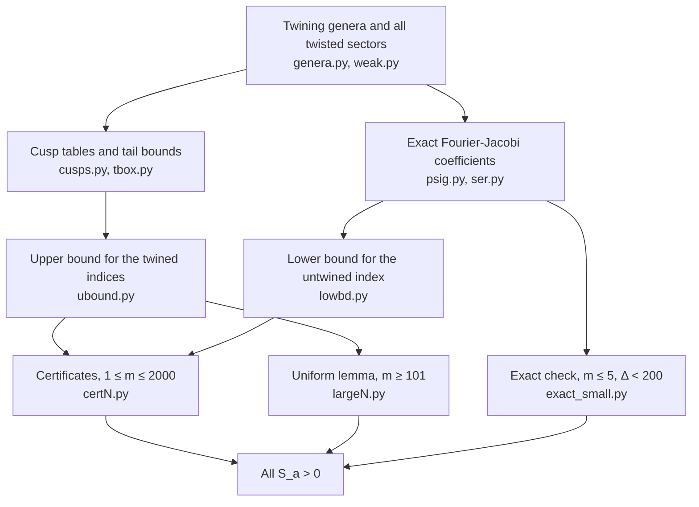

# twined-index-positivity

Programs and output logs for the paper

**Positivity of Twined Black Hole Indices for the Symplectic Automorphisms of K3 of Orders 2, 3 and 4**
by Deep Bhattacharjee.

## The result

In type II string theory on K3 × T², a symplectic automorphism *g* of K3 of order *N* acts on the
microstates of a single-centred quarter-BPS black hole. Let *d* be the index and *d*<sub>*g*<sup>*b*</sup></sub>
the twined indices. The number of states on which *g* acts by e<sup>2πia/N</sup> is

S<sub>a</sub> = (1/N) Σ<sub>b mod N</sub> e<sup>−2πiab/N</sup> d<sub>g<sup>b</sup></sub>.

The paper proves that every S<sub>a</sub> is positive for the classes **2A**, **3A** and **4B** (orders 2, 3, 4),
for all charges in the single-centred region

0 ≤ ℓ ≤ 2 min(m, n), 4mn − ℓ² > 0, with m = P²/2, n = Q²/2, ℓ = Q·P.

This is equivalent to

| N | class | inequality |
|---|---|---|
| 2 | 2A | d > \|d<sub>2A</sub>\| |
| 3 | 3A | d > 2\|d<sub>3A</sub>\| |
| 4 | 4B | d > 2\|d<sub>4B</sub>\| + \|d<sub>2A</sub>\| |

## How the proof is split



| Range of charges (after reduction to 0 ≤ ℓ ≤ m ≤ n) | Method | Program | Log |
|---|---|---|---|
| m ≤ 5, 3m² ≤ Δ < 200 (310 charges) | exact integer computation of d, d<sub>2A</sub>, d<sub>3A</sub>, d<sub>4B</sub> | `exact_small.py` | `logs/exact_small.log` |
| 1 ≤ m ≤ 2000, Δ ≥ D<sub>s</sub>(m) | stepping certificate up to 400m² + 2000, then an explicit inequality | `certN.py` | `logs/certN{2,3,4}_1_2000.log` |
| m ≥ 101, Δ ≥ 3m² | uniform lemma, linear in m | `largeN.py` | `logs/largeN_{2,3,4}.log` |

## Results in the logs

| | N = 2 | N = 3 | N = 4 |
|---|---|---|---|
| values of m certified | 2000 | 2000 | 2000 |
| failed steps | 0 | 0 | 0 |
| steps in total | 10053 | 6096 | 10053 |
| smallest logarithmic gap (at m = 6) | 3.311 | 5.578 | 3.273 |
| uniform lemma threshold (needs ≤ 101) | 18.52 | 12.80 | 19.08 |
| smallest ratio, exact range | 37.699 | 42.571 | 28.189 |

Further checks:

* `logs/gssv_check.log`: all 112 published values of the twined indices for (Q², P²) up to (6, 6)
  (Govindarajan, Samanta, Shanmugapriya, Virmani, Nucl. Phys. B 987 (2023) 116095) are reproduced exactly.
* `logs/cuspcheck_{2,3,4}.log`: the expansion of the Fourier-Jacobi coefficients at the cusps S and H
  agrees with direct evaluation to about 60 digits.
* `logs/tb_run.log`: the tail bounds on every box at every cusp, with remainders below 4.1 × 10⁻¹⁰.
* `logs/lam.log`: the constants λ₁, …, λ₅ of the lower bound for m ≤ 5.
* `logs/genera_N{2,3,4}.log`: integrality of the twisted-sector projections and their polar terms.

## Files

| File | Contents |
|---|---|
| `src/weak.py` | coefficients of the weak Jacobi forms φ<sub>0,1</sub> and φ<sub>−2,1</sub> |
| `src/genera.py` | twining genera, twisted-twining genera φ<sub>(r,s)</sub> and their eigen-projections |
| `src/ser.py` | truncated two-variable integer series (FLINT) |
| `src/psig.py` | exact Fourier-Jacobi coefficients of 1/Φ<sub>g</sub> in the chamber of the attractor point |
| `src/cusps.py` | cusp data for Γ₀(N) and the coefficient tables at each cusp |
| `src/tbox.py` | tail bounds on boxes in (s, β) at every cusp |
| `src/ubound.py` | the upper bound for log \|d<sub>g</sub>\| |
| `src/lowbd.py` | the lower bound for log d (Rossello's bound for m ≥ 6, exact polar terms for m ≤ 5) |
| `src/certN.py` | certificates for 1 ≤ m ≤ 2000 |
| `src/largeN.py` | the uniform lemma for m ≥ 101 |
| `src/exact_small.py` | exact check of the remaining small charges |
| `src/cuspcheck.py` | high-precision check of the cusp expansions |
| `src/gssv_check.py` | comparison with the published tables |
| `run_all.sh` | runs everything and writes the logs |

## Reproducing

Requirements: Python 3.10 or later, and the packages in `requirements.txt`
(`python-flint`, `numpy`, `mpmath`).

```sh
pip install -r requirements.txt
sh run_all.sh
```

The intermediate tables (`*.pkl`) are written to `src/` and are not stored in the repository.
The certificates take most of the time, about 10 to 20 minutes per order on one core.

## Licence

MIT, see `LICENSE`.
